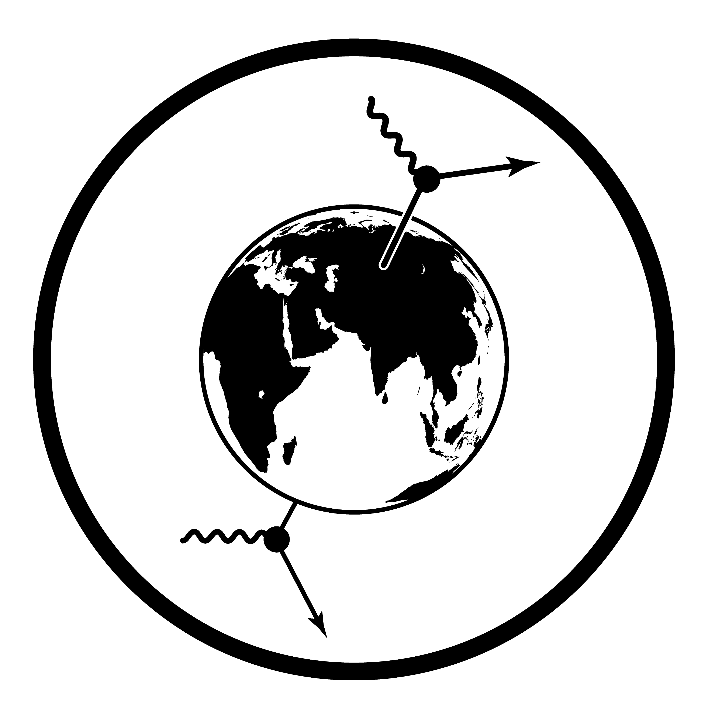

```{=html}
<style>
  .quarto-title-block {
    display: none;
  }
</style>

<div class="course-index course-subpage">
  <nav class="course-profile-links" aria-label="Навигация курса">
    <a href="https://neutrinohit.github.io/">NeutrinoHit</a>
    <a href="https://neutrinohit.github.io/ru/education.html#light-propagation">Карта курса</a>
  </nav>

  <section class="course-intro">
    
    <p class="course-kicker">Курс лекций · русский язык · в работе</p>
    <h1>Распространение света в среде</h1>
    <p>
      Курс лекций по 45 минут о переносе света в рассеивающей и поглощающей
      среде: от баланса фотонов и уравнения переноса (RTE) до ожидаемого
      сигнала оптического модуля. Сначала формулы и их смысл, затем вывод;
      подробные выкладки расположены в табах и продолжают друг друга.
      С первой лекции устанавливаем LightHit, проверяем параметры среды и
      запускаем рассматриваемые примеры: курс служит также руководством к пакету.
    </p>
    <p class="course-author-note">
      Курс DN. Другие курсы и материалы собраны на
      <a href="https://neutrinohit.github.io/ru/">NeutrinoHit</a>.
    </p>
  </section>

  <section aria-label="Лекции курса">
    <h2 class="course-section-title">Лекции</h2>
    <div class="course-card-grid">
      <article class="course-card">
        <span class="course-card-status">01 · 45 минут</span>
        <h3>Уравнение переноса</h3>
        <p>
          Баланс фотонов и вывод RTE, сохранение числа фотонов.
          Точные следствия: однородное поглощение и моменты направленной вспышки.
        </p>
        <div class="course-links">
          <a href="ru/slides/01_definitions.html">Открыть лекцию</a>
          <a href="ru/exercises/01_definitions_exercises.html">Задачи 1.1–1.6</a>
          <a href="ru/practice/01_medium.html">Практика LightHit</a>
        </div>
      </article>
      <article class="course-card">
        <span class="course-card-status">02 · 45 минут</span>
        <h3>Диффузионное приближение</h3>
        <p>
          Вывод из RTE, закон Фика и телеграфное уравнение. Вспышка через Фурье,
          постоянный и направленный источники, область применимости
          и вода нейтринного телескопа.
        </p>
        <div class="course-links">
          <a href="ru/slides/02_diffusion.html">Открыть лекцию</a>
          <a href="ru/exercises/02_diffusion_exercises.html">Задачи 2.1–2.6</a>
          <a href="ru/practice/02_diffusion.html">Сравнить RTE и диффузию</a>
        </div>
      </article>
      <article class="course-card">
        <span class="course-card-status">03 · 45 минут</span>
        <h3>Изотропный источник: точное решение</h3>
        <p>
          Изотропная вспышка и произвольная индикатриса: цепная дробь по
          гармоникам, порядки рассеяния, первый порядок по эллипсоиду,
          телеграфное уравнение и диффузионный предел. Лазер в LightHit: скорость расчёта,
          event viewer и свет на расстояниях 200–300 м.
        </p>
        <div class="course-links">
          <a href="ru/slides/03_isotropic_exact.html">Открыть лекцию</a>
          <a href="ru/exercises/03_isotropic_exact_exercises.html">Задачи 3.1–3.7</a>
          <a href="ru/practice/03_flash.html">Рассчитать вспышку</a>
        </div>
      </article>
      <article class="course-card is-planned">
        <span class="course-card-status">Следующие лекции · готовится</span>
        <h3>Решение RTE и отклик детектора</h3>
        <p>
          Путь от уравнения переноса к ожидаемому числу фотоэлектронов
          в каждом оптическом модуле и временном бине.
        </p>
      </article>
    </div>
  </section>

  <section aria-label="Дополнительные материалы">
    <h2 class="course-section-title">Дополнительные материалы</h2>
    <div class="course-material-grid">
      <article class="course-material">
        <h3>Задачи</h3>
        <p>19 задач к первым трём лекциям: аналитические выводы, размерности,
          пределы и численная проверка с LightHit.</p>
        <p><a href="ru/exercises/index.html">Открыть все задачи</a></p>
      </article>
      <article class="course-material">
        <h3>LightHit на практике</h3>
        <p>Установка, три запускаемых скрипта, пояснения к входу и выходу,
          сравнение с диффузией и временной сигнал от вспышки.</p>
        <p><a href="ru/practice/index.html">Начать с установки</a> ·
          <a href="downloads/lighthit-course-examples.zip">Скачать примеры</a></p>
      </article>
      <article class="course-material">
        <h3>Оптическая модель воды</h3>
        <p>Коэффициенты BaikalWater в LightHit и NTSim, выбранная длина волны,
          единицы и отдельное задание HG-индикатрисы.</p>
        <p><a href="ru/practice/index.html#вода-и-индикатриса">Проверить параметры</a></p>
      </article>
      <article class="course-material">
        <h3>Литература</h3>
        <p>
          S. R. Arridge, J. C. Schotland,
          <a href="https://arxiv.org/abs/0907.2586">Optical tomography: forward and inverse problems</a>.
        </p>
        <p>
          В. Аллахвердян, Д. В. Наумов,
          <a href="https://arxiv.org/abs/2401.15698">Infinite series solution of the time-dependent radiative transfer equation in anisotropically scattering media</a>,
          J. Quant. Spectrosc. Radiat. Transf. <b>326</b>, 109126 (2024),
          <a href="https://doi.org/10.1016/j.jqsrt.2024.109126">doi:10.1016/j.jqsrt.2024.109126</a>.
        </p>
      </article>
    </div>
  </section>
</div>
```
