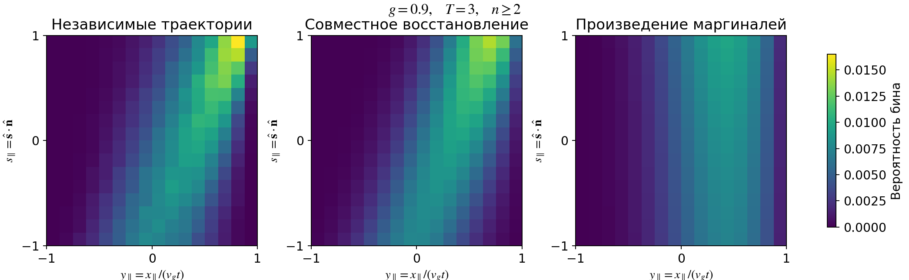

## Предлагаемое восстановление

Для однонаправленной точечной вспышки в бесконечной однородной среде предлагаем

$$
\boxed{f_{\rm rec}=f^{(0)}+f^{(1)}+M_{\ge2}\pi_{\rm ME}},
\qquad I_{\rm rec}=v_g f_{\rm rec}.
$$

Первые две части — точные вклады прямого света и однократного рассеяния.
Остаток восстанавливаем как совместную плотность положения и направления:
она неотрицательна, равна нулю за причинным фронтом и воспроизводит
остаточные моменты до второго порядка, включая смешанные.
При имеющейся моментной информации это обоснованный выбор по критерию
максимума энтропии. Оптимальность по энтропии не означает минимальную ошибку
поля относительно неизвестного точного решения.

Для позднего **пространственного** облака достаточно более простой формулы:

$$
\boxed{\rho_G(\mathbf x,t)=
\frac{Ne^{-\alpha t}}{(2\pi)^{3/2}\sqrt{\det\Sigma(t)}}
\exp\!\left[-\frac12(\mathbf x-\mathbf m(t))^T
\Sigma(t)^{-1}(\mathbf x-\mathbf m(t))\right]}.
$$

Здесь $\mathbf m$ и $\Sigma$ — точный центр и точная пространственная ковариация.
Этот профиль сохраняет нормировку, центр и ковариацию, но допускает фотоны
за фронтом и не задаёт угловое поле. Простое обрезание гауссиана по фронту
изменяет его моменты: после обрезания коэффициенты пришлось бы подбирать заново.

[Вернуться к лекции](../slides/01_definitions.qmd#направленная-вспышка).

## Что известно точно

Моменты в [Allakhverdian–Naumov, §4](https://arxiv.org/pdf/2401.15698)
вычислены с учётом всех порядков рассеяния. Переведём их в обозначения курса.
Пусть вспышка содержит $N$ фотонов, начальное направление — $\hat{\mathbf n}$.

$$
M(t)=Ne^{-\alpha t},\qquad
\pi(\mathbf x,\hat{\mathbf s},t)=\frac{f(\mathbf x,\hat{\mathbf s},t)}{M(t)},
\qquad\int\pi\,d^3x\,d\Omega=1.
$$

Усреднение $\langle h\rangle=\int h\pi\,d^3x\,d\Omega$ глобально:
интегрируем по всему пространству и по всем направлениям при фиксированном времени.
Однородное поглощение отделяется множителем $e^{-\alpha t}$.

Нужны пять групп нормированных моментов:

$$
\mathbf m_x=\langle\mathbf x\rangle,\quad
\mathbf m_s=\langle\hat{\mathbf s}\rangle,\quad
X=\langle\mathbf x\mathbf x^T\rangle,\quad
S=\langle\hat{\mathbf s}\hat{\mathbf s}^T\rangle,\quad
C=\langle\mathbf x\hat{\mathbf s}^T\rangle.
$$

Это не локальные $\rho(\mathbf x,t)$, $\mathbf J(\mathbf x,t)$
и $\Pi(\mathbf x,t)$ из моментного вывода диффузии. Из глобальных моментов
нельзя сразу получить плотность или направление потока в данной точке.

### Точный вывод через генератор RTE

При $p=p(\hat{\mathbf s}\cdot\hat{\mathbf s}')$ определим

$$
\beta_l=\int_{S^2}P_l(\hat{\mathbf s}\cdot\hat{\mathbf s}')p\,d\Omega,
\qquad \gamma_l=v_g\mu_s(1-\beta_l).
$$

Нормировка даёт $\beta_0=1$, а $\beta_1=g$.
Для HG $\beta_l=g^l$; для произвольной фазовой функции $\beta_2$ — независимый параметр.

Обратный генератор движения и рассеяния действует на наблюдаемую $h$:

$$
\mathcal A h=v_g\hat{\mathbf s}\cdot\nabla_x h
+v_g\mu_s\left[\int_{S^2}p(\hat{\mathbf s}',\hat{\mathbf s})
h(\mathbf x,\hat{\mathbf s}')\,d\Omega'-h(\mathbf x,\hat{\mathbf s})\right].
$$

После пространственного и углового интегрирования RTE:

$$
\frac{d\langle h\rangle}{dt}=\langle\mathcal A h\rangle.
$$

Собственные функции углового оператора первого и второго рангов дают

$$
\mathcal A\hat s_i=-\gamma_1\hat s_i,
\qquad
\mathcal A(\hat s_i\hat s_j)
=-\gamma_2\left(\hat s_i\hat s_j-\frac{\delta_{ij}}3\right).
$$

Для положения и смешанных произведений:

$$
\mathcal A x_i=v_g\hat s_i,\qquad
\mathcal A(x_i\hat s_j)=v_g\hat s_i\hat s_j-\gamma_1x_i\hat s_j,
\qquad
\mathcal A(x_ix_j)=v_g(x_i\hat s_j+x_j\hat s_i).
$$

Таким образом, получаем **точную**, уже замкнутую цепь:

$$
\boxed{
\begin{aligned}
\dot{\mathbf m}_s&=-\gamma_1\mathbf m_s,&
\dot{\mathbf m}_x&=v_g\mathbf m_s,\\
\dot S&=-\gamma_2(S-\mathbf1/3),&
\dot C&=v_gS-\gamma_1C,\\
\dot X&=v_g(C+C^T).
\end{aligned}}
$$

Замыкание $P_1$ здесь не используется. Начальные значения:
$\mathbf m_s(0)=\hat{\mathbf n}$, $S(0)=\hat{\mathbf n}\hat{\mathbf n}^T$,
а $\mathbf m_x(0)=0$, $C(0)=X(0)=0$.

### Решение цепи

Пусть $Q=\hat{\mathbf n}\hat{\mathbf n}^T-\mathbf1/3$. Тогда

$$
\mathbf m_s=e^{-\gamma_1t}\hat{\mathbf n},\qquad
\mathbf m_x=\frac{v_g}{\gamma_1}(1-e^{-\gamma_1t})\hat{\mathbf n},
\qquad S=\frac{\mathbf1}{3}+e^{-\gamma_2t}Q.
$$

Введём функции с непрерывными пределами при совпадении или обнулении скоростей:

$$
A_1(t)=\frac{1-e^{-\gamma_1t}}{\gamma_1},\qquad
B_{12}(t)=\frac{e^{-\gamma_2t}-e^{-\gamma_1t}}{\gamma_1-\gamma_2},
$$

$$
F_1(t)=\frac{t}{\gamma_1}-\frac{1-e^{-\gamma_1t}}{\gamma_1^2},
\qquad
H_{12}(t)=\frac{
(1-e^{-\gamma_2t})/\gamma_2-(1-e^{-\gamma_1t})/\gamma_1
}{\gamma_1-\gamma_2}.
$$

Получаем

$$
\boxed{C=v_g\left[\frac{A_1}{3}\mathbf1+B_{12}Q\right]},
\qquad
\boxed{X=2v_g^2\left[\frac{F_1}{3}\mathbf1+H_{12}Q\right]},
\qquad\boxed{\Sigma=X-\mathbf m_x\mathbf m_x^T}.
$$

Например, при $\gamma_1=\gamma_2=\gamma$:

$$
B_{12}=te^{-\gamma t},\qquad
H_{12}=\frac{1-(1+\gamma t)e^{-\gamma t}}{\gamma^2}.
$$

Для вычислений на малых временах удобнее ряды или интегральные формы
$C=v_g\int_0^t e^{-\gamma_1(t-u)}S(u)du$,
$X=v_g\int_0^t(C+C^T)du$: они избегают вычитания близких чисел.
При $\gamma_1,\gamma_2>0$ и $t\gg\max(\gamma_1^{-1},\gamma_2^{-1})$
$\Sigma=2Dt\,\mathbf1+O(\ell_*^2)$, где $D=v_g^2/(3\gamma_1)$.

## Почему моментов недостаточно для единственного поля

Конечный набор интегральных ограничений оставляет бесконечно много
допустимых распределений. Изменение формы, ортогональное всем заданным
моментным функциям, не меняет ни один известный момент.
Поэтому точность центра и ширины не контролирует автоматически
высоту пика, форму фронта, редкие хвосты или сигнал маленького детектора.

| Восстановление | Что сохраняет | Чего не обеспечивает |
|---|---|---|
| Смещённое диффузионное ядро | Позднюю массу и предельный центр | Точную ковариацию на конечном времени |
| Гаусс с точными $\mathbf m_x,\Sigma$ | Пространственные моменты до второго порядка | Причинный носитель и угловую структуру |
| Произведение пространственной и угловой плотностей | Заданные отдельные моменты | Смешанные моменты $C$ |
| Совместный maxent-остаток с точными $n=0,1$ | Все заданные совместные моменты, положительность, носитель и первые два порядка | Локальную точность RTE без отдельной проверки |

Выбираем последнюю конструкцию, когда требуется приближение полного поля
по имеющимся точным данным. Для поздней пространственной плотности используем
гауссову формулу как простой предел, а не подменяем ею полное угловое поле.

## Сначала извлекаем сингулярные части

Обозначим $\nu=v_g\mu_s$, $\eta=\nu t$.
Нормированные вклады первых двух порядков имеют вид

$$
\pi_0=e^{-\eta}\delta^{(3)}(\mathbf x-v_gt\hat{\mathbf n})
\delta_{S^2}(\hat{\mathbf s}-\hat{\mathbf n}),
$$

$$
\pi_1=\nu e^{-\eta}p(\hat{\mathbf s}\cdot\hat{\mathbf n})
\int_0^t\delta^{(3)}\!\left[
\mathbf x-v_g\bigl(u\hat{\mathbf n}+(t-u)\hat{\mathbf s}\bigr)\right]du.
$$

Здесь $\delta_{S^2}$ нормирована по $d\Omega$.
$\pi_0$ и $\pi_1$ — плотности с массами
$P_0=e^{-\eta}$ и $P_1=\eta e^{-\eta}$, а не с единичной нормировкой.
Умножение на $M(t)$ даёт $f^{(0)}$ и $f^{(1)}$.

Гладкая экспонента не может воспроизвести эти дельта-компоненты.
Поэтому сохраняем их точно и восстанавливаем лишь остаток с массой

$$
M_{\ge2}=M W,\qquad W=1-P_0-P_1.
$$

Для любой моментной функции $\phi$:

$$
\boxed{\langle\phi\rangle_{\ge2}=
\frac{\langle\phi\rangle-P_0\langle\phi\rangle_0
-P_1\langle\phi\rangle_1}{W}}.
$$

Средние справа условны на число рассеяний. Вычитать средние без весов нельзя.

### Моменты однократного рассеяния

При условии ровно одного рассеяния время столкновения $u$ равномерно на $[0,t]$.
Положим $\xi=u/t$, $\mathbf y=\mathbf x/(v_gt)$.

$$
\mathbf y=\xi\hat{\mathbf n}+(1-\xi)\hat{\mathbf s},\qquad
\hat{\mathbf s}\sim p(\hat{\mathbf s}\cdot\hat{\mathbf n}).
$$

Обозначим $S_1=(1-\beta_2)\mathbf1/3+\beta_2\hat{\mathbf n}\hat{\mathbf n}^T$.
С учётом $\langle\xi\rangle=1/2$, $\langle\xi^2\rangle=1/3$,
$\langle\xi(1-\xi)\rangle=1/6$ получаем

$$
\begin{aligned}
\langle\hat{\mathbf s}\rangle_1&=g\hat{\mathbf n},&
\langle\mathbf y\rangle_1&=\frac{1+g}{2}\hat{\mathbf n},\\
\langle\hat{\mathbf s}\hat{\mathbf s}^T\rangle_1&=S_1,&
\langle\mathbf y\hat{\mathbf s}^T\rangle_1&=\frac12(g\hat{\mathbf n}\hat{\mathbf n}^T+S_1),\\
\langle\mathbf y\mathbf y^T\rangle_1&=\frac13[(1+g)\hat{\mathbf n}\hat{\mathbf n}^T+S_1].
\end{aligned}
$$

В нулевом порядке $\mathbf y=\hat{\mathbf s}=\hat{\mathbf n}$.
Таким образом, для вычитания не требуется новая многомерная траекторная интеграция.

## Энтропийный критерий и его вывод

При фиксированном времени вводим причинную область
$\mathcal D_t=B_{v_gt}(0)\times S^2$ и равномерную нормированную меру

$$
U_t=\frac1{V_t\,4\pi},\qquad V_t=\frac{4\pi}{3}(v_gt)^3.
$$

Выбираем плотность, которая минимизирует относительную энтропию
относительно этой меры:

$$
\min_{\pi\ge0} \int_{\mathcal D_t}\pi\log\frac{\pi}{U_t}\,d^3x\,d\Omega,
\qquad\int\pi=1,\qquad\int\phi_k\pi=m_k^{\ge2}.
$$

На фиксированной области это равносильно максимизации энтропии Шеннона.
Равномерная мера — явный дополнительный выбор: иной априорный профиль
приведёт к другой реконструкции.
Вариация лагранжиана по $\pi$ даёт

$$
\log(\pi/U_t)+1-\lambda_0-\sum_k\lambda_k\phi_k=0.
$$

После нормировки:

$$
\boxed{\pi_{\boldsymbol\lambda}
=\frac{U_t\exp(\boldsymbol\lambda\cdot\boldsymbol\phi)}{Z(\boldsymbol\lambda)}},
\qquad
Z=\int_{\mathcal D_t}U_t e^{\boldsymbol\lambda\cdot\boldsymbol\phi}\,d^3x\,d\Omega.
$$

Набор функций включает компоненты $\mathbf x$, $\hat{\mathbf s}$,
$\mathbf x\mathbf x^T$, $\hat{\mathbf s}\hat{\mathbf s}^T$
и $\mathbf x\hat{\mathbf s}^T$. Поэтому показатель экспоненты квадратичен:

$$
\mathbf a\cdot\mathbf x+\mathbf b\cdot\hat{\mathbf s}
+\mathbf x^TA\mathbf x+\mathbf x^TB\hat{\mathbf s}
+\hat{\mathbf s}^TC_s\hat{\mathbf s}.
$$

Матрицы $A$ и $C_s$ симметричны. Ограничение $\operatorname{tr}S=1$
линейно зависит от нормировки; его исключаем, например выбирая бесследовую $C_s$.
Это обеспечивает независимость параметров, необходимую для устойчивого подбора.

Энтропийное восстановление с моментными ограничениями и условиями существования
рассмотрено у [Borwein–Lewis](https://doi.org/10.1137/0803012).
Здесь оно применяется к **глобальному совместному** распределению;
это не локальное угловое замыкание $M_2$.

### Двойственная задача

Коэффициенты находятся из выпуклой задачи

$$
\min_{\boldsymbol\lambda}
\Psi(\boldsymbol\lambda)=\log Z(\boldsymbol\lambda)
-\boldsymbol\lambda\cdot\mathbf m^{\ge2}.
$$

Дифференцирование даёт

$$
\nabla\Psi=\langle\boldsymbol\phi\rangle_{\boldsymbol\lambda}
-\mathbf m^{\ge2},\qquad
\nabla^2\Psi=\operatorname{Cov}_{\boldsymbol\lambda}(\boldsymbol\phi).
$$

Гессиан неотрицателен. При внутреннем допустимом наборе моментов
и независимых функциях существует единственная конечная экспоненциальная
реконструкция. На границе допустимых моментов могут потребоваться сингулярные
пределы: конечная гладкая плотность не гарантирована.

## Семь параметров вместо общего тензорного набора

Для направленной вспышки среда и начальные условия осесимметричны.
Ось направим вдоль $\hat{\mathbf n}$ и используем безразмерное положение
$\mathbf y=\mathbf x/(v_gt)$. Достаточны семь независимых функций:

$$
\boldsymbol\phi=\left(
 y_\parallel,\ s_\parallel,\ y_\parallel^2,\ |\mathbf y_\perp|^2,\
 s_\parallel^2,\ y_\parallel s_\parallel,\
 \mathbf y_\perp\cdot\hat{\mathbf s}_\perp\right).
$$

Две линейные функции задают средние; две пространственные квадратичные —
ширину вдоль и поперёк оси; одна угловая — квадруполь;
последние две — смешанные корреляции. Остальные компоненты определены симметрией,
а $|\hat{\mathbf s}|^2=1$ фиксирует след углового момента.

При $z=y_\parallel$, $a=|\mathbf y_\perp|^2/(1-z^2)$,
$u=s_\parallel$ и относительном азимуте $\varphi$:

$$
-1\le z,u\le1,\quad0\le a\le1,\quad0\le\varphi<2\pi,
$$

$$
\mathbf y_\perp\cdot\hat{\mathbf s}_\perp
=\sqrt{a(1-z^2)(1-u^2)}\cos\varphi.
$$

После интегрирования общего азимута равномерная мера принимает вид

$$
dU=\frac{3}{8}(1-z^2)\,dz\,da\,du\,\frac{d\varphi}{2\pi}.
$$

Её интеграл равен единице. Интеграл по $\varphi$ можно выполнить через
модифицированную функцию Бесселя $I_0$, если требуется уменьшить размерность
квадратуры. В проверке ниже подбор выполняется прямой квадратурой,
а вероятности бинов вычисляются с аналитическим интегрированием азимута.

## Алгоритм по шагам

1. Вычислить точные $\mathbf m_x,\mathbf m_s,X,S,C$ и массу $M(t)$.
2. Получить массы $P_0,P_1,W$ и условные моменты порядков $0,1$.
3. Вычесть их с весами; перейти к семи остаточным моментам в переменных $\mathbf y$.
4. Подобрать семь коэффициентов из двойственной задачи. Считать экспоненты через
   вычитание максимального показателя; масштабировать моментные функции.
5. Уточнить квадратуру и проверить все моментные ограничения повторно.
6. Собрать $f_{\rm rec}$, сохранив точные сингулярные части. Получить
   $\rho_{\rm rec}=\int f_{\rm rec}d\Omega$,
   $\mathbf J_{\rm rec}=v_g\int\hat{\mathbf s}f_{\rm rec}d\Omega$ и
   $I_{\rm rec}=v_g f_{\rm rec}$.
7. Проверить требуемые локальные наблюдаемые против полного RTE или независимых
   траекторий. Не использовать одну проверку глобальных моментов как замену этому шагу.

При $\eta\ll1$ имеем $W=\eta^2/2-\eta^3/3+O(\eta^4)$.
Прямое вычитание остаточных моментов тогда плохо обусловлено. Для этого режима
нужны ряды или повышенная точность; выполненная проверка не охватывает его.
В пределе полностью прямого или строго обратного рассеяния остаток может
оставаться сингулярным: данную гладкую модель туда не переносим.

## Выполненная численная проверка

Использована HG-функция, безразмерные единицы
$\ell_*=\tau_*=v_g=1$, $T=t/\tau_*$ и $\alpha=0$.
Однородное поглощение не меняет нормированную форму, поэтому отдельно
в этом опыте не варьируется.

Для каждого теста построено $120\,000$ независимых траекторий.
Межстолкновенные времена экспоненциальны со средним $1-g$;
косинус рассеяния выбран по HG, азимут равномерен.
Начальная точка — ноль, направление — ось $z$.
Для сравнения остатка оставлены траектории с двумя и более рассеяниями.
Подбор использует точные моменты, **не моменты этой выборки**.

Прямая квадратура для подбора уточнена с $18$ до $26$ узлов по каждой
из трёх непрерывных переменных; число азимутальных узлов — соответственно
$36$ и $52$. Вероятность каждого бина вычислена отдельной интеграцией
внутри его границ, а не простым отнесением квадратурных узлов к бинам.

Измерено расстояние полной вариации

$$
\operatorname{TV}_{\rm bin}
=\frac12\sum_{i,j}|P_{ij}^{\rm MC}-P_{ij}^{\rm model}|,
$$

для $16\times16$ равномерных бинов в
$(y_\parallel,s_\parallel)\in[-1,1]^2$.
Сравнение «произведение» использует те же маргинали совместной реконструкции,
$P_{ij}^{\rm prod}=(\sum_jP_{ij}^{\rm model})(\sum_iP_{ij}^{\rm model})$.
Поэтому оно проверяет пользу сохранения корреляции, а не превосходство над
всеми возможными моментными методами.

| $g$ | $T$ | Траекторий остатка | $\operatorname{TV}_{\rm bin}$ совместной модели | $\operatorname{TV}_{\rm bin}$ произведения |
|---|---:|---:|---:|---:|
| $0$ | $1$ | $32\,027$ | $7.39\%$ | $19.08\%$ |
| $0.9$ | $1$ | $119\,937$ | $17.01\%$ | $38.89\%$ |
| $0.9$ | $3$ | $120\,000$ | $5.69\%$ | $20.82\%$ |
| $0.9$ | $10$ | $120\,000$ | $2.70\%$ | $8.71\%$ |

Все семь заданных ограничений воспроизведены с абсолютной невязкой
меньше $1.3\cdot10^{-9}$ после уточнения квадратуры.
При переносе коэффициентов с грубой квадратуры на уточнённую максимальное
изменение моментной невязки не превышало $4.91\cdot10^{-9}$.
Точные остаточные моменты согласуются с независимыми выборочными:
максимальное отклонение среди семи компонент и четырёх тестов —
$1.50$ оценённых стандартных ошибок среднего.

Процент в таблице относится к указанной проекции и включает статистическую
погрешность выборки. Он не является ошибкой пяти переменных полного поля,
ошибкой временного профиля детектора или равномерной оценкой по пространству.
Особенно при $T=1$ форма остатка ещё заметно отличается от максимума энтропии.

Воспроизводимый расчёт:
[исходник](assets/check_reconstruction.py),
[численные результаты и коэффициенты](assets/checks.json).
Требуются NumPy и SciPy; расчёт запускается отдельно от сборки лекции.

## Что остаётся проверить перед применением к сигналу ОМ

Реконструкция подбирается независимо при каждом времени.
Поэтому совпадение глобальных моментов не гарантирует локальное уравнение
непрерывности или локальное RTE. Для использования в расчёте детектора нужны
проверки плотности и углового распределения около фронта, в боковой и обратной
областях, а также свёртки с угловой эффективностью ОМ и временными окнами.
Полезен отдельный контроль остатка

$$
\mathcal R_{\rm cont}=\partial_t\rho_{\rm rec}
+\nabla\cdot\mathbf J_{\rm rec}+\alpha\rho_{\rm rec}
$$

после вспышки. В выполненной проверке этот локальный остаток и конкретный
детекторный сигнал не оценивались. Подтверждена совместимость с моментами,
причинным носителем и улучшение одной выбранной проекции относительно
факторизованной модели.
