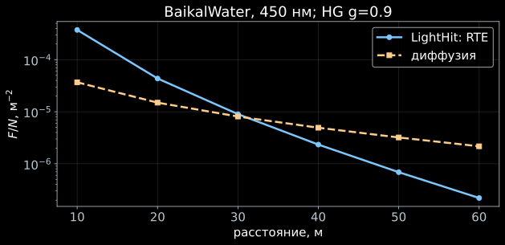

[← Установка](index.html) · [Лекция 2](../slides/02_diffusion.html) · [Задачи](../exercises/02_diffusion_exercises.html)

## Одна величина в двух приближениях

Ищем флюенс $F(r)$ от изотропной вспышки $N=1$ при 450 нм.
LightHit вычисляет его при $\omega=0$, а диффузионная формула даёт

$$
F_D(r)=\frac{Nv_g}{4\pi Dr}\,e^{-r\sqrt{\alpha/D}},\qquad
D=\frac{v_g}{3\mu_s(1-g)},\quad\alpha=v_g\mu_a.
$$

Это временной интеграл скорости флюенса, а не число фотоэлектронов ОМ.
Здесь $\mu_a/\mu_s'=40$, поэтому сравнение намеренно проверяет пределы
диффузионного приближения для принятой модели воды.

## Запуск

```bash
python 02_diffusion.py
python 02_diffusion.py --refine --output .work/refined02
```

[Полный скрипт](../../examples/02_diffusion.py) · [Настройки и среда](../../examples/course_medium.py).

В скрипте используется публичный интерфейс:

```python
solver = lh.PointGreenSolver(medium, settings)
result = solver.solve([0.0], positions, direction=None, photons=1.0)
fluence = result.charge_per_m2
```

`charge_per_m2` в этом интерфейсе — скалярный флюенс: название поля не означает
детекторный заряд. `direction=None` задаёт изотропную вспышку.

## Результат

{fig-alt="Флюенс от вспышки в модели BaikalWater на 450 нм: RTE и диффузия"}

В `fluence.csv` три столбца: расстояние, флюенс RTE и диффузионный флюенс.
`summary.json` дополнительно содержит их отношение.

Сравните обычные и уточнённые настройки. Численная сходимость RTE и
применимость диффузионного приближения — две отдельные проверки.

