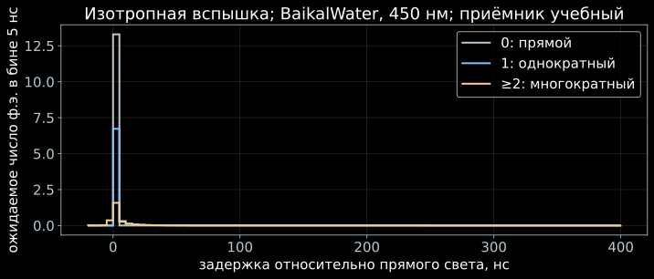

[← Установка](index.html) · [Лекция 3](../slides/03_isotropic_exact.html) · [Задачи](../exercises/03_isotropic_exact_exercises.html)

## Вход и выход

Задаём $10^8$ фотонов, 450 нм и расстояние 30 м. Оптические коэффициенты —
[проверенный образец BaikalWater](index.html#вода-и-индикатриса), HG $g=0.9$.

LightHit решает RTE в пространстве Фурье и возвращает три порядка отдельно.
Порядки 0 и 1 при считывании интегрируются в физическом времени; по частотам
обращается остаток $\ge2$.

## Запуск

```bash
python 03_flash.py
python 03_flash.py --refine --output .work/refined03
```

[Полный скрипт](../../examples/03_flash.py) · [Общие функции](../../examples/course_medium.py).

Первый расчёт получает спектр; затем `result.readout(edges, sigma_ns=0)`
считает интегралы по временным бинам. Фронт находится из
`result.front_time_ns`. В `bins.csv` времена **абсолютные**, а на рисунке
показана задержка относительно прямого света.

## Учебный приёмник

Пусть приёмник изотропен, его площадь $A=0.13$ м$^2$ и эффективность
$\varepsilon=0.20$ постоянны. Тогда

$$
\begin{aligned}
Q^{(n)}&=A\varepsilon F^{(n)},\\
B_b^{(n)}&=A\varepsilon\int_{t_b}^{t_{b+1}}\Phi^{(n)}(t)\,dt.
\end{aligned}
$$

Это явная модель приёмника. Настоящий ОМ дополнительно имеет угловую и
спектральную чувствительность; эти функции понадобятся в следующих лекциях.

{fig-alt="Число фотоэлектронов в бинах по 5 нс для прямого, однократно и многократно рассеянного света"}

`summary.json` содержит заряд по всем временам и сумму в выбранном окне,
а также диагностику отрицательной массы и массы до фронта. Значения не
обнуляются автоматически: при конечных сетках эти показатели помогают
обнаружить численные осцилляции.

В этом коротком примере полоса ограничена $\omega\le1.2$ нс$^{-1}$.
При стандартных настройках масса до фронта составляет около 1.7% полного
заряда: это численная ошибка обращения остатка $\ge2$. Уточнение `--refine`
не расширяет полосу, поэтому само по себе не устраняет эту ошибку.
Для исследования первых наносекунд отдельно расширяйте полосу и верхний
предел $k$, проверяя диагностику. Интегральный флюенс и форма сигнала
у фронта требуют разных проверок точности.

Контроль заряда по всем временам для выбранного приёмника:

| Порядок | Ожидаемый заряд, ф.э. |
|---|---|
| 0 | 13.30 |
| 1 | 7.42 |
| $\ge2$ | 2.64 |

Заряд рассчитывается при $\omega=0$; сумма в конечном временном окне может
отличаться. Это различие также записано в `summary.json`.

## Готовый пример с детектором и просмотром

Установленный пакет содержит команду `lighthit-demo`. Она создаёт
синтетический детектор и **синтетическую** среду; коэффициенты этого примера
отличаются от BaikalWater выше.

```bash
lighthit-demo geometry --clusters 1
lighthit-demo cache --cache .work/demo-cache --sources laser
lighthit-demo run --cache .work/demo-cache --sources laser --output .work/demo
```

Откройте `.work/demo/viewer.html` в браузере. Подготовка выполняется один раз,
затем готовые таблицы используются повторно. Команды `cache` и `run` используют
одни и те же профиль, среду и геометрию.

