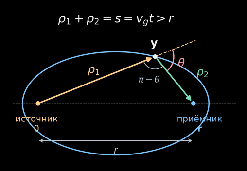
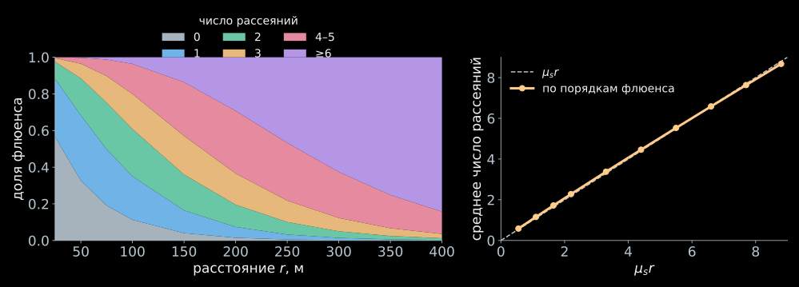
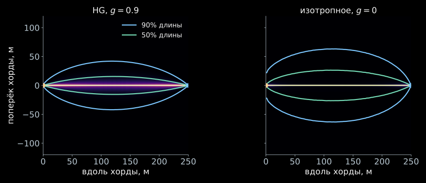
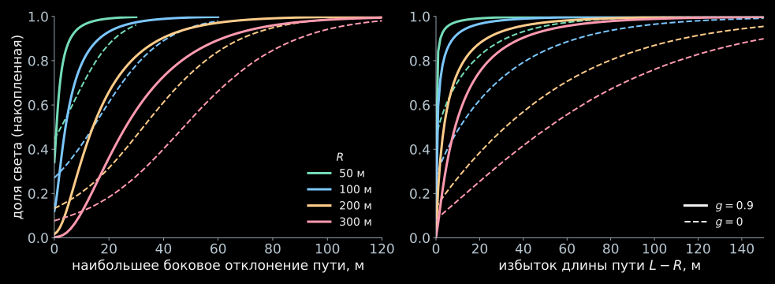

## Источник, вода и длина волны

:::: {.panel-tabset}

### BaikalWater

- Оптическую модель `BaikalWater` читают LightHit и NTSim; коэффициенты зависят от длины волны.
- HG с $g=0.9$ — отдельный выбор модели индикатрисы в LightHit.

| $\lambda$, нм | $\mu_a$, м$^{-1}$ | $\mu_s$, м$^{-1}$ | $n_g$ |
|---|---|---|---|
| 450 | 0.0760 | 0.0190 | 1.371324 |
| 532 | 0.0588 | 0.0140 | 1.360099 |

- Практический расчёт этой лекции использует **450 нм** и эти коэффициенты.
- [Модель, интерполяция и единицы](../practice/index.html#вода-и-индикатриса).

### Учебная среда

- Встроенный пример `lighthit-demo` содержит синтетическую среду и геометрию.
- Замеры скорости, viewer и рисунки путей ниже относятся к учебной среде:

$$
\mu_a=0.020,\quad\mu_s=0.022\ \text{м}^{-1},\quad g=0.9.
$$

- Эти числа удобны для сравнения методов, но **не являются коэффициентами BaikalWater**.
- В численных проверках формул учебная среда также указывается явно.
- При смене оптики нужно пересчитать таблицы и траектории; готовые рисунки нельзя просто переименовать.

::::

## Лазер: чего мы хотим добиться

:::: {.columns}

::::: {.column width="70%"}

<iframe data-src="assets/03_isotropic_exact/laser-viewer.html"
  class="rte-viewer" loading="lazy" title="Event viewer: лазер"></iframe>

:::::

::::: {.column width="30%"}

Калибровочный лазер:

- точечная изотропная вспышка;
- вода рассеивает вперёд ($g=0.9$) и поглощает;
- нужно число фотонов в каждом ОМ и его зависимость от времени;
- сфера — фронт света, ОМ светятся по ожидаемому числу фотоэлектронов.

[Открыть отдельно](assets/03_isotropic_exact/laser-viewer.html){target="_blank"}

:::::

::::

## Сколько стоит такой расчёт

:::: {.panel-tabset}

### Что измерено

Синтетические среда и детектор из примеров LightHit: 5 кластеров,
240 ОМ на расстояниях 0–390 м от вспышки. Среда: $g=0.9$,
$\mu_a=0.020$, $\mu_s=0.022$ м$^{-1}$.

| Этап | Время |
|---|---|
| подготовка решения, **один раз** для среды и детектора | 59 с |
| отклик 240 ОМ × 160 временных бинов, первый вызов | 0.05 с |
| тот же вызов повторно | 0.02 с |

Полный Baikal-GVD (935 активных ОМ), лазер 532 нм, готовая подготовка:
0.11 с на отклик.

### Почему так быстро

- Решение ищется в пространстве Фурье, где задача алгебраическая.
- Для изотропной вспышки на каждую пару $(k,\omega)$ нужна одна цепная дробь:
  это и есть тема лекции.
- Подготовка не зависит от положения вспышки и от числа её фотонов.
- Остаётся сумма по частотам для каждого ОМ: стоимость $N_{\rm OM}\times N_\omega$.

### Монте-Карло

- Доля фотонов, дошедших до 300 м: $1.4\cdot10^{-3}$ на сфере (слайд «Какой свет приходит издалека»).
- ОМ площадью $0.13$ м$^2$ ловит фотон с вероятностью
  $p_{\rm hit}\approx1.4\cdot10^{-3}\cdot0.13/(4\pi\,300^2)\approx1.6\cdot10^{-10}$.
- Это оценка для почти радиального света: первое пересечение сферы и локальный флюенс
  различаются; угловая чувствительность и эффективность ОМ здесь не включены.
- 1% статистики — $10^4$ попаданий, то есть $6\cdot10^{13}$ фотонов на **один** ОМ.
- При $10^7$ фотонов в секунду это 70 суток. Решатель даёт ожидание сразу, без выборки.

::::

## Разминка: что именно решаем

:::: {.panel-tabset}

### Условие

- Источник: $N$ фотонов в точке $\mathbf x=0$ в момент $t=0$, **изотропно**.
- Среда однородная: $\mu_a$, $\mu_s$, $\mu_t=\mu_a+\mu_s$, скорость $v_g$.
- Среда бесконечная, границ нет; длина волны фиксирована.
- Фазовая функция $p(\hat{\mathbf s}\cdot\hat{\mathbf s}')$ **произвольная**, $\int p\,d\Omega=1$.
- Ищем скорость флюенса $\Phi(\mathbf x,t)=\int I\,d\Omega$ (лекция 1).

$$
\frac1{v_g}\partial_tI+\hat{\mathbf s}\cdot\nabla I+\mu_tI
=\mu_s\!\int p(\hat{\mathbf s}\cdot\hat{\mathbf s}')\,I'\,d\Omega'
+\frac N{4\pi}\,\delta^{(3)}(\mathbf x)\,\delta(t).
$$

### Обозначения

| Величина | Смысл | Единицы |
|---|---|---|
| $\Phi=v_g\rho=\int I\,d\Omega$ | скорость флюенса | фотон/(м$^2$·нс) |
| $F=\int\Phi\,dt$ | флюенс | фотон/м$^2$ |
| $k$, $\omega$ | пространственная и временная частоты распределения | м$^{-1}$, нс$^{-1}$ |
| $\mu_a,\mu_s,d_0,D_\ell$ | коэффициенты на единицу длины | м$^{-1}$ |

- $\alpha=v_g\mu_a$ — скорость поглощения, нс$^{-1}$.
- $k,\omega$ описывают распределение фотонов, а не оптические колебания поля.

### Два индекса

- $\ell$ — **номер угловой гармоники**: $a_0$ — скорость флюенса, $a_1$ — поток.
- $n$ — **число рассеяний**: $n=0$ — прямой свет, $n=1$ — одно рассеяние.
- Один порядок $n=1$ содержит все гармоники $\ell$; гармоника $\ell=0$ содержит все порядки $n$.
- Для HG: $g_\ell=g^\ell$, где $g=\langle\cos\theta\rangle$:

$$
p(\cos\theta)=\frac{1-g^2}{4\pi(1+g^2-2g\cos\theta)^{3/2}},\qquad |g|<1.
$$

### Что значит «точно»

- В пространстве Фурье задача зависит от одного угла — между $\mathbf k$ и $\hat{\mathbf s}$.
- $\tilde\Phi(k,\omega)$ — замкнутое выражение: цепная дробь по гармоникам $P_\ell$,
  любые моменты $g_\ell$, без обрезания по $\ell$.
- Порядок 0: $N e^{-d_0r}/(4\pi r^2)$ в $(r,\omega)$; полный образ в $(k,\omega)$ равен $NA$.
- Порядок 1 в $(r,t)$ — интеграл по эллипсоиду с полной фазовой функцией.
- Порядки $\ge2$ — обратное преобразование Фурье точного образа.
- Для изотропного рассеяния всё сворачивается в $\arctan$ и $\ln$.

### План

- Преобразование Фурье по $\mathbf x$ и $t$.
- Разложение по полиномам Лежандра: рассеяние диагонально.
- Трёхчленная цепочка и цепная дробь для $\tilde\Phi$.
- Возврат в $(r,\omega)$.
- Порядки рассеяния; порядок 1 в $(r,t)$.
- Обрыв цепочки даёт $P_1$ и телеграфное уравнение; затем — диффузионный предел.
- Какой свет приходит с расстояний 200–300 м.
- Основной маршрут — первые табы и физические проверки; остальные табы сохраняют подробный вывод.

::::

## Шаг 1. Преобразование Фурье

:::: {.panel-tabset}

### Определение

$$
\tilde f(\mathbf k,\omega)=\int f(\mathbf x,t)\,
e^{-i\mathbf k\cdot\mathbf x+i\omega t}\,d^3x\,dt .
$$

- Преобразуем по $\mathbf x$ и $t$; направление $\hat{\mathbf s}$ — параметр.
- Знак в $e^{+i\omega t}$ выбран так, что $\partial_t\to-i\omega$.
- Интеграл по частям, $f\to0$ при $|\mathbf x|,|t|\to\infty$:

$$
\partial_tf\;\to\;-i\omega\tilde f,\qquad
\nabla f\;\to\;i\mathbf k\,\tilde f .
$$

### Каждый член уравнения

- $\dfrac1{v_g}\partial_tI\;\to\;-\dfrac{i\omega}{v_g}\tilde I$.
- $\hat{\mathbf s}\cdot\nabla I\;\to\;i\,\hat{\mathbf s}\cdot\mathbf k\,\tilde I=ik\mu\,\tilde I$,
  где $\mu=\hat{\mathbf k}\cdot\hat{\mathbf s}$.
- $\mu_tI\to\mu_t\tilde I$; интеграл по $\hat{\mathbf s}'$ с $p$ не затрагивается.
- Источник: $\int\delta^{(3)}(\mathbf x)\delta(t)\,e^{-i\mathbf k\cdot\mathbf x+i\omega t}=1$,
  поэтому он даёт $N/(4\pi)$.

### Уравнение

Положим $d_0=\mu_t-i\omega/v_g$. Тогда

$$
\boxed{(d_0+ik\mu)\,\tilde I(\mu)=\mu_s\!\int p(\hat{\mathbf s}\cdot\hat{\mathbf s}')\,\tilde I(\mu')\,d\Omega'+\frac N{4\pi}.}
$$

- $d_0$ — затухание плюс частота: $\operatorname{Re}d_0=\mu_t>0$.
- Дифференциальное уравнение стало алгебраическим по $\mathbf x$ и $t$.
- Изотропный источник и вращательная симметрия среды оставляют один угол: $\tilde I=\tilde I(\mu)$.

::::

## Шаг 2. Гармоники

:::: {.panel-tabset}

### Разложение

$$
\tilde I(\mu)=\sum_{\ell=0}^\infty\frac{2\ell+1}{4\pi}\,a_\ell\,P_\ell(\mu),
\qquad a_\ell=\int P_\ell(\mu)\,\tilde I\,d\Omega .
$$

- $P_\ell$ ортогональны: $\int P_\ell P_{\ell'}d\Omega=\dfrac{4\pi}{2\ell+1}\delta_{\ell\ell'}$.
- $a_0=\int\tilde I\,d\Omega=\tilde\Phi$ — то, что мы ищем.
- $\tilde{\mathbf J}=a_1\hat{\mathbf k}$ — вектор потока; $a_2$ задаёт квадрупольную часть.
- Дальше: превратить уравнение для $\tilde I(\mu)$ в уравнения для чисел $a_\ell$.

### Рассеяние диагонально

Разложим фазовую функцию: $p=\sum_\ell\frac{2\ell+1}{4\pi}\,g_\ell\,P_\ell(\hat{\mathbf s}\cdot\hat{\mathbf s}')$,
$g_\ell=2\pi\int_{-1}^{1}p(u)P_\ell(u)\,du$, где $u=\cos\theta$ — косинус угла рассеяния.

- Теорема сложения: $P_\ell(\hat{\mathbf s}\cdot\hat{\mathbf s}')=\dfrac{4\pi}{2\ell+1}\sum_mY_{\ell m}(\hat{\mathbf s})\,Y^*_{\ell m}(\hat{\mathbf s}')$.
- Ортогональность $Y_{\ell m}$ по $\hat{\mathbf s}'$ оставляет в интеграле только степень $\ell$.

$$
\int p(\hat{\mathbf s}\cdot\hat{\mathbf s}')\,P_\ell(\mu')\,d\Omega'=g_\ell\,P_\ell(\mu)
\quad\Rightarrow\quad
\mu_s\!\int p\,\tilde I'\,d\Omega'=\mu_s\sum_\ell\frac{2\ell+1}{4\pi}\,g_\ell a_\ell P_\ell(\mu).
$$

Рассеяние умножает $\ell$-ю гармонику на $\mu_sg_\ell$ и не смешивает гармоники.

### Член с волновым вектором

Он **смешивает** соседние гармоники:

$$
\mu\,P_\ell=\frac{(\ell+1)P_{\ell+1}+\ell P_{\ell-1}}{2\ell+1}.
$$

- Тогда $ik\mu\,\tilde I=\dfrac{ik}{4\pi}\sum_m a_m\bigl[(m+1)P_{m+1}+mP_{m-1}\bigr]$.
- Коэффициент при $P_\ell$ берёт $m=\ell-1$ и $m=\ell+1$:

$$
\frac{ik}{4\pi}\bigl[\ell\,a_{\ell-1}+(\ell+1)\,a_{\ell+1}\bigr].
$$

### Цепочка

Собираем коэффициенты при $P_\ell$ во всех членах уравнения. Положим $D_\ell=d_0-\mu_sg_\ell$:

$$
\boxed{(2\ell+1)\,D_\ell\,a_\ell+ik\bigl[\ell\,a_{\ell-1}+(\ell+1)\,a_{\ell+1}\bigr]=N\,\delta_{\ell0}.}
$$

- Это бесконечная трёхдиагональная система для $a_0,a_1,a_2,\dots$
- Правая часть отлична от нуля только при $\ell=0$: изотропный источник.
- Для осесимметричного источника меняется правая часть; оператор переноса тот же.

::::

## Шаг 3. Цепная дробь

:::: {.panel-tabset}

### Первые строки

$$
\begin{aligned}
D_0a_0+ik\,a_1&=N,\\
3D_1a_1+ik(a_0+2a_2)&=0,\\
5D_2a_2+ik(2a_1+3a_3)&=0.
\end{aligned}
$$

- Рассеяние диагонально, перенос связывает только соседей.
- Выражаем $a_2$ через $a_1$, затем $a_1$ через $a_0$: остаётся одно уравнение для $a_0$.
- Каждая связь проходится дважды: коэффициенты $1^2,2^2,3^2,\ldots$ появляются в дроби.
- Два множителя $ik$ вместе со знаком исключения дают **плюс** $k^2$.

### Исключаем с хвоста

- Для $\ell\ge1$ правой части нет. Делим на $a_{\ell-1}$ и вводим $\rho_\ell=a_\ell/a_{\ell-1}$:

$$
(2\ell+1)D_\ell\,\rho_\ell+ik\ell+ik(\ell+1)\,\rho_{\ell+1}\rho_\ell=0
\;\Rightarrow\;
\rho_\ell=\frac{-ik\ell}{(2\ell+1)D_\ell+ik(\ell+1)\rho_{\ell+1}}.
$$

- Умножим на $ik\ell$: $\;ik\ell\,\rho_\ell=\dfrac{\ell^2k^2}{(2\ell+1)D_\ell+ik(\ell+1)\rho_{\ell+1}}.$
- Уравнение $\ell=0$: $D_0a_0+ik\,a_1=N$, то есть $a_0=\dfrac N{D_0+ik\rho_1}$.

### Результат

Подставляем $ik\rho_1$, затем $ik\cdot2\rho_2$ и так далее:

$$
\boxed{\tilde\Phi(k,\omega)=\cfrac{N}{D_0+\cfrac{k^2}{3D_1+\cfrac{4k^2}{5D_2+\cfrac{9k^2}{7D_3+\cdots}}}},
\qquad D_\ell=d_0-\mu_sg_\ell .}
$$

- $D_0=\mu_a-i\omega/v_g$, потому что $g_0=1$.
- Для обычной интегрируемой $p$: $g_\ell\to0$, $D_\ell\to d_0$; хвост описывает свободный перенос с затуханием $\mu_t$.
- Число нужных членов растёт с $k/\mu_t$; сходимость проверяется добавлением членов.

### Хвост

- Однородная трёхчленная цепочка при $k>0$ имеет два независимых решения; физическое убывает с ростом $\ell$.
- Обратная рекурсия выбирает это убывающее, или **минимальное**, решение.
- Если индикатриса оборвана при $L$, выше него $D_\ell=d_0$: свободный хвост можно исключить, сохранив его влияние на $a_L$.
- Поэтому конечное число моментов индикатрисы не требует обрывать сам перенос.
- Отдельно проверяем сходимость по $L$ индикатрисы и по глубине численного хвоста.

### Проверки

- $k=0$: $\tilde\Phi=N/(\mu_a-i\omega/v_g)$ — интеграл по всему пространству.
- Обращение по времени: $\int\Phi\,d^3x=Nv_g e^{-\alpha t}$ при $t>0$;
  значит $\int\rho\,d^3x=Ne^{-\alpha t}$ — число сохранившихся фотонов.
- $\omega=0$, $k=0$: $\int\!\Phi\,d^3x\,dt=N/\mu_a$: каждый фотон живёт $1/(v_g\mu_a)$, скорость умножает на $v_g$.
- Обрыв **всей цепочки** на $\ell=1$: $\tilde\Phi=N/[D_0+k^2/(3D_1)]$ — телеграфное уравнение; диффузионный предел разберём отдельно.
- Изотропное $p$ ($g_\ell=0$ при $\ell\ge1$): $D_\ell=d_0$ при $\ell\ge1$ — известная дробь для арктангенса (ниже).

::::

## Шаг 4. Возврат в координатное пространство

:::: {.panel-tabset}

### Пространства

$$
\Phi(\mathbf x,t)\ \longrightarrow\ \tilde\Phi(k,\omega)
\ \longrightarrow\ \Phi(r,\omega)\ \longrightarrow\ \Phi(r,t).
$$

- Тильда обозначает преобразование **по пространству и времени**.
- $\Phi(r,\omega)=\int\Phi(r,t)e^{i\omega t}\,dt$ — преобразование только по времени.
- В частности, $\Phi(r,0)=F(r)$ — флюенс от вспышки.
- Сначала интегрируем по направлениям $\mathbf k$, затем по $k$, затем по $\omega$.

### По углам

$\tilde\Phi$ зависит только от $k=|\mathbf k|$. Обратное преобразование по $\mathbf x$:

$$
\Phi(r,\omega)=\frac1{(2\pi)^3}\int\tilde\Phi(k,\omega)\,e^{i\mathbf k\cdot\mathbf x}\,d^3k .
$$

- Сферические координаты в $\mathbf k$ с осью вдоль $\mathbf x$: $d^3k=k^2dk\,d\cos\vartheta\,d\phi$.
- $\displaystyle\int e^{ikr\cos\vartheta}\,d\cos\vartheta=\frac{2\sin kr}{kr}$, азимут даёт $2\pi$.

$$
\boxed{\Phi(r,\omega)=\frac1{2\pi^2\,r}\int_0^\infty k\,\sin(kr)\;\tilde\Phi(k,\omega)\,dk .}
$$

### Остаток

- При $k\to\infty$: $A\sim\pi/(2k)$; баллистический вклад делает интеграл осциллирующим без обычной сходимости.
- Формулу обращения для полного поля понимаем с регуляризацией, например $e^{-\varepsilon k}$ и пределом $\varepsilon\to0^+$.
- Практически выделяем порядки 0 и 1 и обращаем более гладкий остаток:

$$
\tilde\Phi^{(\ge2)}=\tilde\Phi-NA-\tilde\Phi^{(1)}.
$$

- Прямой свет возвращается аналитически, порядок 1 — интегралом в координатах.
- При численном обращении остатка проверяем верхний предел и снятие сглаживания.

### По k

- Подынтегральная функция осциллирует по $k$ с периодом $2\pi/r$:
  при $r=300$ м период $0.02$ м$^{-1}$.
- **Панель** — короткий отрезок $k$ шириной порядка периода. Отрезок $[0,k_{\max}]$ делится на панели.
- На каждой панели — квадратура Гаусса–Лежандра с $n$ узлами:
  точна для многочленов степени $2n-1$.
- $n\approx10$ — начальный практический выбор; точность для синуса проверяется сравнением с $2n$ узлами.
- Сумма по панелям — составная квадратура.
- Верхний предел $k_{\max}$, ширина панелей и сглаживание края — отдельные параметры сходимости.

### По времени

$$
\boxed{\Phi(r,t)=\frac1{2\pi}\int_{-\infty}^{\infty}\Phi(r,\omega)e^{-i\omega t}\,d\omega.}
$$

- Для вещественного сигнала $\Phi(r,-\omega)=\Phi(r,\omega)^*$.
- При выбранном знаке экспоненты затухающие полюса лежат в нижней полуплоскости $\omega$.
- Причинное решение равно нулю при $t<r/v_g$: это обязательная проверка численного обращения.
- Временной бин $[t_b,t_{b+1}]$ получает флюенс $\int_{t_b}^{t_{b+1}}\Phi\,dt$;
  отклик ОМ дополнительно учитывает площадь, направление и эффективность.

::::

## Шаг 5. Порядки рассеяния

:::: {.panel-tabset}

### Свободный пролёт

- Выключаем **приход от рассеяния**: $\mu_s g_\ell\to0$, но сохраняем $d_0=\mu_a+\mu_s-i\omega/v_g$.
- Это фотоны **без единого столкновения**: уход из прямого света по-прежнему содержит $\mu_s$.
- Получаем $a_\ell^{(0)}=N A_\ell$:

$$
A_\ell(k,\omega)=\frac12\int_{-1}^{1}\frac{P_\ell(\mu)\,d\mu}{d_0+ik\mu},
\qquad
\boxed{A_0=A=\frac{\arctan(k/d_0)}{k}.}
$$

- $A_0$: $\int_{-1}^1\frac{d\mu}{d_0+ik\mu}=\frac1{ik}\ln\frac{d_0+ik}{d_0-ik}=\frac2k\arctan\frac k{d_0}$.

### Рекурсия

- Умножим $(d_0+ik\mu)^{-1}(d_0+ik\mu)=1$ на $P_\ell/2$ и проинтегрируем.
- Используем рекурсию для $\mu P_\ell$ и $\tfrac12\int P_\ell d\mu=\delta_{\ell0}$:


$$
(\ell+1)A_{\ell+1}=\frac{(2\ell+1)\bigl(\delta_{\ell0}-d_0A_\ell\bigr)}{ik}-\ell A_{\ell-1}.
$$

- При $k=0$ используем предел $A_\ell=\delta_{\ell0}/d_0$.
- Рекурсия верна аналитически; счёт вверх по $\ell$ может усиливать округление.
- В численном решении выбираем убывающее решение обратной рекурсией и проверяем сходимость.

### Порядок 0

Образ сферической волны $e^{-d_0r}/(4\pi r^2)$:

$$
\int e^{-i\mathbf k\cdot\mathbf x}\frac{e^{-d_0r}}{4\pi r^2}\,d^3x
=\int_0^\infty e^{-d_0r}\frac{\sin kr}{kr}\,dr=\frac1k\arctan\frac k{d_0}=A .
$$

- Угловой интеграл даёт $\sin(kr)/(kr)$.
- $\Lambda(k)=\int_0^\infty e^{-d_0r}\frac{\sin kr}r\,dr$: $\Lambda(0)=0$,
  $\Lambda'(k)=\frac{d_0}{d_0^2+k^2}$, откуда $\Lambda=\arctan(k/d_0)$.
- В $(r,\omega)$: $\Phi^{(0)}(r,\omega)=N e^{-d_0r}/(4\pi r^2)$.
- В $(r,t)$: $\Phi^{(0)}(r,t)=N e^{-\mu_tr}\delta(t-r/v_g)/(4\pi r^2)$ — прямой свет на фронте.

### Порядок 1

- Прямой свет рассеивается: источник $\mu_s\sum_\ell\frac{2\ell+1}{4\pi}\,g_\ell\,NA_\ell\,P_\ell(\mu)$.
- Один свободный пролёт ($1/(d_0+ik\mu)$) и интеграл по сфере:

$$
\boxed{\tilde\Phi^{(1)}=N\mu_s\sum_{\ell=0}^{\infty}(2\ell+1)\,g_\ell\,A_\ell^{\,2}.}
$$

- $\ell=0$ ($g_0=1$) — изотропная часть.
- Это $A_\ell^2$, без комплексного сопряжения: два последовательных свободных пролёта.
- Для HG $g_\ell=g^\ell$: при $g=0.9$ даже $g^{24}=0.080$.
  Нужное $L$ определяется сходимостью ответа, а не одним малым моментом.
- Порядки $\ge2$ — разность точного $\tilde\Phi$ и $NA+\tilde\Phi^{(1)}$.

### Изотропный случай

При $p=1/(4\pi)$ все $g_\ell=0$ при $\ell\ge1$, остаётся $\ell=0$:
$D_0=d_0-\mu_s$, $D_\ell=d_0$.

- Дробь Ламберта: $\arctan z=\cfrac{z}{1+\cfrac{z^2}{3+\cfrac{4z^2}{5+\cdots}}}$, поэтому
  дробь с $D_\ell=d_0$ равна $A$.
- Остаётся геометрическая прогрессия:

$$
\boxed{\tilde\Phi=\frac{N A}{1-\mu_sA}=N\sum_{n=0}^\infty\mu_s^{\,n}A^{\,n+1},}
\qquad
\tilde\Phi^{(1)}=N\mu_sA^2 .
$$

::::

## Геометрия одного рассеяния

:::: {.panel-tabset}

### Эллипсоид

::::: {.columns}

:::::: {.column width="58%"}

{.rte-figure .rte-ellipsoid fig-alt="Сечение эллипсоида с фокусами в источнике и приёмнике; точка рассеяния, два пролёта и угол отклонения θ"}

::::::

:::::: {.column width="42%"}

- Точки рассеяния при данном $t$ лежат на **эллипсоиде вращения**.
- На рисунке — сечение через фокусы. Ось вращения проходит через источник и приёмник.
- $\theta$ — угол между входящим и выходящим направлениями. Внутренний угол: $\pi-\theta$.

::::::

:::::

### Знак косинуса

- Внутренний угол при $\mathbf y$ равен $\pi-\theta$, поэтому теорема косинусов даёт:

$$
r^2=\rho_1^2+\rho_2^2-2\rho_1\rho_2\cos(\pi-\theta)
=\rho_1^2+\rho_2^2+2\rho_1\rho_2\cos\theta.
$$

- При $s=r$ точки лежат на отрезке между фокусами; внутри отрезка $\theta=0$.
- При $s>r$ эллипсоид имеет ненулевую поперечную ширину.
- При $s<r$ эллипсоида нет: фотон не может опередить прямой свет.

::::

## Порядок 1 в координатах

:::: {.panel-tabset}

### Интеграл

Фотон летит от источника до точки $\mathbf y$, рассеивается и летит к приёмнику в $\mathbf r$.
Пусть $\rho_1=|\mathbf y|$, $\rho_2=|\mathbf r-\mathbf y|$, $\theta$ — угол отклонения в $\mathbf y$.

$$
\Phi^{(1)}(r,t)=N\mu_s\int d^3y\,
\frac{e^{-\mu_t(\rho_1+\rho_2)}}{4\pi\rho_1^2}\,\frac{p(\cos\theta)}{\rho_2^2}\,
\delta\!\left(t-\frac{\rho_1+\rho_2}{v_g}\right).
$$

- Первый множитель — прямой свет до $\mathbf y$; $\mu_s$ — вероятность рассеяния на единице длины.
- Затем излучение в направлении приёмника с плотностью $p(\cos\theta)$.
- Дельта-функция: $\rho_1+\rho_2=v_gt\equiv s$ — эллипсоид с фокусами в источнике и приёмнике.

### Координаты

Фокусы в $0$ и $\mathbf r$:

$$
\xi=\frac{\rho_1+\rho_2}{r},\quad\eta=\frac{\rho_1-\rho_2}{r},\quad
d^3y=\frac{r^3}8(\xi^2-\eta^2)\,d\xi\,d\eta\,d\phi,
\quad\rho_1\rho_2=\frac{r^2}4(\xi^2-\eta^2).
$$

- Интеграл по азимуту $\phi$ даёт $2\pi$: $\;d^3y/(\rho_1\rho_2)^2\to\dfrac{4\pi}{r}\dfrac{d\xi\,d\eta}{\xi^2-\eta^2}$.
- Дельта-функция: $\delta(t-r\xi/v_g)=\dfrac{v_g}r\,\delta(\xi-s/r)$, значит $\xi=s/r$.
- Остаётся интеграл по $\eta\in[-1,1]$.

### Угол

Теорема косинусов для треугольника «источник – $\mathbf y$ – приёмник»,
$r^2=\rho_1^2+\rho_2^2+2\rho_1\rho_2\cos\theta$:

$$
\cos\theta=\frac{2-\xi^2-\eta^2}{\xi^2-\eta^2},
\qquad \rho_{1,2}=\frac r2(\xi\pm\eta).
$$

- В средней плоскости эллипсоида ($\eta=0$): $\cos\theta=2/\xi^2-1$.
- При $s\to r^+$ и фиксированном $|\eta|<1$: $\theta\to0$; у фокусов предел неравномерен.
- При $s\gg r$ получаем $\theta\to\pi$: свет должен развернуться.

### Результат

$$
\boxed{\Phi^{(1)}(r,t)=\frac{N\mu_s v_g\,e^{-\mu_tv_gt}}{r^2}
\int_{-1}^{1}\frac{p(\cos\theta)\,d\eta}{\xi^2-\eta^2},
\qquad\xi=\frac{v_gt}r>1.}
$$

- Подстановка $\eta=\xi\tanh y$: $\;d\eta/(\xi^2-\eta^2)=dy/\xi$, $|y|<Y=\tfrac12\ln\frac{\xi+1}{\xi-1}$.
- $\cos\theta=1-2\delta\cosh^2y$, $\delta=1-r^2/s^2$.
- При $s<r$: $\Phi^{(1)}=0$; рассеянный свет не опережает фронт.

$$
\Phi^{(1)}=\frac{2N\mu_sv_g\,e^{-\mu_ts}}{r\,s}\int_0^{Y}p\bigl(1-2\delta\cosh^2y\bigr)\,dy .
$$

### Изотропное

При $p=1/(4\pi)$ интеграл равен $Y/(4\pi)$:

$$
\boxed{\Phi^{(1)}(r,t)=\frac{N\mu_s v_g\,e^{-\mu_tv_gt}}{4\pi\,r\,v_gt}
\ln\frac{v_gt+r}{v_gt-r}.}
$$

- Фронт $s\to r$: логарифмическая особенность, интегрируемая.
- Поздно, $s\gg r$: $Y\to r/s$, $\theta\to\pi$, $\Phi^{(1)}\to2N\mu_sv_g\,p(-1)\,e^{-\mu_ts}/s^2$.
- Для HG $p(-1)=\frac{1-g^2}{4\pi(1+g)^3}$ мало: вытянутая индикатриса подавляет
  однократное рассеяние назад.
- Для HG интеграл по $y$ эллиптический, считается квадратурой.

::::

## От цепной дроби к диффузии

:::: {.panel-tabset}

### Два обрыва

- **Обрыв индикатрисы:** положить $g_\ell=0$ при $\ell>L$, сохранив свободный хвост гармоник $a_\ell$.
- **Приближение $P_1$:** положить $a_\ell=0$ при $\ell\ge2$, оборвав всю цепочку.
- Это разные операции: изотропная индикатриса имеет только $g_0=1$, но её решение содержит все $a_\ell$.
- $P_1$ даёт телеграфное уравнение; дополнительный медленный предел даёт диффузию.

### Телеграф

- При $a_2=0$: $a_1=-ik a_0/(3D_1)$, откуда

$$
\tilde\Phi_{P_1}=\frac{N}{D_0+k^2/(3D_1)}
=\frac{ND_1}{D_0D_1+k^2/3},\qquad \mu_s'=\mu_s(1-g).
$$

- Умножаем числитель и знаменатель последней дроби на $v_g^2$:

$$
\tilde\Phi_{P_1}=\frac{Nv_g(-i\omega+\alpha+v_g\mu_s')}
{(-i\omega+\alpha)(-i\omega+\alpha+v_g\mu_s')+v_g^2k^2/3}.
$$

- Знаменатель — дисперсионный многочлен телеграфного уравнения из лекции 2.
- Числитель также нужен: он задаёт возбуждение мод вспышкой.

### Диффузионный предел

- Обозначим $q=-i\omega+\alpha$. Медленная ветвь: $|q|\ll v_g\mu_s'$.
- Тогда $D_1=(q+v_g\mu_s')/v_g\simeq\mu_s'$:

$$
\tilde\Phi_{\rm diff}\simeq\frac{Nv_g}{-i\omega+\alpha+Dk^2},
\qquad D=\frac{v_g}{3\mu_s'}.
$$

- Обращение: $(\partial_t+\alpha-D\nabla^2)\Phi=Nv_g\delta^{(3)}(\mathbf x)\delta(t)$.
- Для медленной ветви нужен $k\ll\mu_s'$; для стационарного поля также $\mu_a\ll\mu_s'$.
- $P_1$ сохраняет конечную скорость фронта $v_g/\sqrt3$; диффузия имеет бесконечный фронт. Истинный фронт идёт со скоростью $v_g$.

::::

## Изотропное рассеяние: точная мода

:::: {.panel-tabset}

### Полюс

- Только в этом блоке $g=0$: $\tilde\Phi=NA/(1-\mu_s A)$.
- Нуль знаменателя: $\arctan(k/d_0)=k/\mu_s$, то есть $d_0=k\cot(k/\mu_s)$.
- Положим $\sigma=-i\omega/v_g$, тогда $d_0=\mu_t+\sigma$:

$$
\boxed{\sigma(k)=k\cot\frac{k}{\mu_s}-\mu_a-\mu_s.}
$$

- Вклад полюса при $t>0$ пропорционален $e^{v_g\sigma(k)t}$: затухающая мода.
- Моды с разными $k$ складываются в обратном преобразовании; один полюс не описывает всё решение.

### Малые k

- $x\cot x=1-x^2/3-x^4/45-\ldots$, где $x=k/\mu_s$:

$$
\sigma(k)=-\mu_a-\frac{k^2}{3\mu_s}-\frac{k^4}{45\mu_s^3}-\ldots.
$$

- $v_g\sigma=-\alpha-Dk^2-\ldots$, где $D=v_g/(3\mu_s)$.
- Первые два члена дают показатель диффузии $e^{-(Dk^2+\alpha)t}$.
- Следующий член — первая поправка к точной медленной моде.

### Числа

Учебная среда: $\mu_a=0.020$, $\mu_s=0.022$ м$^{-1}$; $\sigma$ в м$^{-1}$:

| $k$, м$^{-1}$ | точно | диффузия | с $k^4$ |
|---|---|---|---|
| 0.005 | −0.020380 | −0.020379 | −0.020380 |
| 0.010 | −0.021536 | −0.021515 | −0.021536 |
| 0.020 | −0.026423 | −0.026061 | −0.026395 |

- При росте $k$ следующий член всё заметнее приближает точную моду.
- Это сравнение мод при $g=0$, а не оценка ошибки полного сигнала с HG.

### Граница моды

- На физической ветви мода существует при $0\le k<k_c$ и $d_0>0$.
- При $d_0\to0^+$: $\arctan(k/d_0)\to\pi/2$, откуда $k_c=\pi\mu_s/2$.
- При $k\to k_c$ полюс сливается с непрерывным спектром
  $\sigma=-\mu_t-ik\mu$, $|\mu|\le1$ — разрезом $A$.
- Непрерывный спектр нужен, в частности, для восстановления раннего света и точного причинного фронта.
- При $k\ll\mu_s$ медленная мода приближается диффузией.

### Стационарно

- При $\omega=0$ продолжим $k$ до $i\kappa$, где $0<\kappa<\mu_t$:

$$
1=\frac{\mu_s}{\kappa}\operatorname{artanh}\frac{\kappa}{\mu_t}.
$$

- Дальний стационарный вклад полюса убывает как $e^{-\kappa r}/r$.
- Для той же среды: точно $\kappa=0.039806$ м$^{-1}$;
  диффузия даёт $\sqrt{3\mu_a\mu_s}=0.036332$ м$^{-1}$.
- Расхождение около 10% ожидаемо: $\mu_a/\mu_s\approx0.91$, слабое поглощение здесь не выполнено.

::::

## Дальний свет: учебная среда

:::: {.panel-tabset}

### Порядки

{.rte-figure .rte-short fig-alt="Доли флюенса по числу рассеяний и среднее число рассеяний при данном расстоянии"}

- По порядкам флюенса, $g=0.9$. На 250 м: прямого света $0.5\%$, однократно рассеянного $2.7\%$, $\ge3$ раз — $90\%$.
- HG предпочитает малые углы, но допускает большие отклонения; дошедший свет отобран также поглощением.

### Среднее

Среднее число рассеяний, взвешенное флюенсом при данном $r$:

$$
\bar n(r)=\frac{\sum_n nF^{(n)}(r)}{\sum_n F^{(n)}(r)}.
$$

- Оно близко к $\mu_s r$ (пунктир на рисунке), но не равно ему тождественно.
- На 100 м: $\bar n=2.278$, тогда как $\mu_s r=2.2$; на 300 м: $6.585$ против $6.6$.
- Пуассоновское среднее $\mu_s v_gt$ относится к фиксированному времени и всему пространству.
- Отбор по месту регистрации и интегрирование по времени меняют распределение числа рассеяний.

### Трубка путей

{.rte-figure .rte-tube fig-alt="Плотность путей фотонов, дошедших до 250 м, для g=0.9 и g=0"}

- Первое пересечение сферы $R=250$ м; веса $e^{-\mu_aL}$ учитывают поглощение.
- Яркость — длина путей на единицу объёма; каждое поперечное сечение нормировано отдельно.
- Линии — 50% и 90% взвешенной длины: в середине 15 / 42 м при $g=0.9$, 26 / 63 м при $g=0$.

### Разброс

{.rte-figure .rte-short fig-alt="Накопленные распределения бокового отклонения и избытка пути"}

- Сплошные — $g=0.9$, пунктир — $g=0$; цвет — расстояние $R$.
- Слева: наибольшее боковое отклонение пути от хорды. Справа: избыток длины пути.
- $g=0.9$, $R=300$ м: 90% света отклоняется не более чем на 61 м и проходит не более чем на 39 м лишнего.
- При $g=0$: 89 м и 150 м.

### Числа и причины

| $R$, м | $g$ | отклонение: медиана / 90%, м | избыток пути: медиана / 90%, м | первое пересечение |
|---|---|---|---|---|
| 100 | 0.9 | 4 / 17 | 0.6 / 8 | $1.2\cdot10^{-1}$ |
| 100 | 0 | 14 / 41 | 11 / 65 | $5.6\cdot10^{-2}$ |
| 300 | 0.9 | 26 / 61 | 9 / 39 | $1.4\cdot10^{-3}$ |
| 300 | 0 | 47 / 89 | 52 / 150 | $4.4\cdot10^{-5}$ |

- Последний столбец — вероятность первого пересечения сферы с учётом поглощения; это не локальный флюенс.
- Избыток 9 м — задержка $9/v_g\approx41$ нс при $n_g=1.36$.
- Трубка описывает геометрию путей; углы прихода измеряются отдельно через $\hat{\mathbf s}\cdot\hat{\mathbf r}$.

### Оценка длины

- Для гладкого пути $u(z)$ с малым наклоном, $u(0)=u(R)=0$:

$$
\Delta L=\int_0^R\!\bigl(\sqrt{1+u'(z)^2}-1\bigr)dz
\simeq\frac12\int_0^R u'(z)^2dz.
$$

- Возьмём **параболическую дугу** $u(z)=4\rho z(R-z)/R^2$:

$$
\Delta L\simeq\frac12\frac{16\rho^2}{R^4}\int_0^R(R-2z)^2dz
=\frac83\frac{\rho^2}{R}.
$$

- Для $R=300$ м: $\rho=26$ м даёт 6 м, $\rho=61$ м — 33 м: масштаб близок к данным.
- Коэффициент $8/3$ относится к выбранной дуге; максимальное отклонение не определяет длину случайной ломаной.

::::

## Проверки и физический смысл

:::: {.panel-tabset}

### Диффузия?

- Для BaikalWater при 450 нм: $\mu_s=0.019$ м$^{-1}$, HG $g=0.9$, поэтому

$$
\ell_s=\frac1{\mu_s}\approx53\ \text{м},\qquad
\ell_*=\frac1{\mu_s(1-g)}\approx526\ \text{м}.
$$

- На 300 м: $\mu_s r=5.7$, но $r/\ell_*=0.57$ — изотропизация ещё не произошла.
- В неотобранном ансамбле HG после шести рассеяний память о начальном направлении равна $g^6\approx0.53$.
- Поглощение дополнительно отбирает короткие пути: $\ell_a=1/\mu_a\approx13.2$ м.
- Поэтому много рассеяний ещё не означает диффузионный режим; здесь нужно точное решение.

### Сходимость

- Для HG сравниваем обрыв индикатрисы $L=24,128,256$, сохраняя свободный хвост переноса.
- Пример: $k=2.5$ м$^{-1}$, $\omega=0.45$ нс$^{-1}$.

| Сравнение | Относительное отличие |
|---|---|
| полный образ, $L=24$ против $256$ | $5.0\cdot10^{-4}$ |
| образ порядка 1, $L=24$ против $256$ | $2.61\cdot10^{-2}$ |
| полный образ, $L=128$ против $256$ | $2.2\cdot10^{-11}$ |

- Согласие двух формул при одинаковом $L$ проверяет реализацию, а не ошибку обрыва HG.
- Эти числа относятся к отдельному образу Фурье; точность временного сигнала проверяется отдельно.

### Числа

Все ошибки — **относительные**, $N=1$; параметры — в следующем табе.

| Что сравнивается | Ошибка |
|---|---|
| цепная дробь и решатель с той же индикатрисой, $L=24$ | $\le7\cdot10^{-16}$ |
| HG: интеграл по эллипсоиду и расчёт порядка 1 в координатах | $\le3.1\cdot10^{-13}$ |
| $g=0$: формула с $\ln$ и интеграл по эллипсоиду | $\le1.1\cdot10^{-13}$ |
| $g=0$: $F^{(1)}$, интеграл по времени и обратный $k$-интеграл | $\le9\cdot10^{-14}$ |
| порядок 1: сумма по $\ell$ и производная дроби | $\le10^{-10}$ |

### Условия

- Учебная среда для проверок: $\mu_a=0.020$, $\mu_s=0.022$ м$^{-1}$, $n_g=1.36$; для HG $g=0.9$.
- Порядок 1: $r=5,30,100$ м, $v_gt/r=1.0001,1.1,2,10$.
- Флюенс при $g=0$: $r=10,30,80$ м; для дроби — пять пар $(k,\omega)$, включая большой $k$.
- Для независимой проверки порядка 1 вводим множитель $\lambda$ **только в приход от рассеяния**, сохраняя $d_0$:

$$
D_\ell(\lambda)=d_0-\lambda\mu_sg_\ell,\qquad
\left.\frac{\partial\tilde\Phi_\lambda}{\partial\lambda}\right|_{\lambda=0}
=\tilde\Phi^{(1)}.
$$

### Вопросы

- Почему $\int\Phi\,d^3x=Nv_g e^{-\alpha t}$, хотя фотонов осталось $Ne^{-\alpha t}$?
- Можно ли получить порядок $n=1$, оставив только гармонику $\ell=1$?
- Почему нулевые $g_\ell$ при $\ell\ge1$ не означают нулевые $a_\ell$?
- Почему на 300 м многократно рассеянный свет ещё не обязан быть диффузионным?

### Ответы

- $\Phi=v_g\rho$: число фотонов — интеграл плотности $\rho$.
- Порядок $n=1$ содержит все угловые гармоники; $\ell$ и $n$ — разные индексы.
- Даже при изотропном рассеянии перенос $ik\mu$ связывает соседние гармоники.
- На 450 нм транспортная длина BaikalWater равна $526$ м, а поглощение отбирает короткие пути.
- Главная цепочка решения: **симметрия → гармоники → цепная дробь → порядки → обращение**.

::::


## Практика 3. Рассчитать вспышку

:::: {.panel-tabset}

### Запуск

- $10^8$ фотонов, 450 нм, расстояние 30 м; BaikalWater и HG $g=0.9$.
- Это монохроматическая задача сегодняшней лекции.

```bash
python 03_flash.py
python 03_flash.py --refine --output .work/refined03
```

- `spectrum.npz`: три порядка в частотах; `bins.csv`: три порядка во времени.
- `summary.json`: полный заряд, сумма в окне и численная диагностика.
- [Установка и полный пример](../practice/03_flash.html).

### Временной сигнал

{.rte-figure fig-alt="Сигнал от вспышки на 30 м в модели BaikalWater, отдельно по трём порядкам"}

- Время фронта $r/v_g=137.23$ нс; на рисунке показана задержка от этого момента.
- Учебный приёмник изотропен: $A=0.13$ м$^2$, $\varepsilon=0.20$; $Q=A\varepsilon F$.

### Детектор и viewer

- Готовый `lighthit-demo` использует **синтетические** среду и детектор.

```bash
lighthit-demo cache --cache .work/demo-cache --sources laser
lighthit-demo run --cache .work/demo-cache --sources laser --output .work/demo
```

- Откройте `.work/demo/viewer.html`; готовые таблицы переиспользуются.
- Для Baikal-GVD дальше подключим реальную геометрию и чувствительность ОМ.
- [Задачи 3.1–3.7](../exercises/03_isotropic_exact_exercises.html).

::::
